# 医院信息管理系统数据库设计说明书

**隆承志 华南理工大学计算机科学与工程学院**

---

## 目录

* **第一篇 需求分析**
    * 第 1 章 调查用户需求
        * 1.1 医院的组织机构
        * 1.2 各部门的业务活动
        * 1.3 用户对系统的要求
        * 1.4 确定系统的边界
    * 第 2 章 系统功能设计
        * 2.1 门诊管理子系统
        * 2.2 药品管理子系统
        * 2.3 住院管理子系统
        * 2.4 门诊管理子系统与住院管理子系统交叉的部分
        * 2.5 行政管理子系统
    * 第 3 章 数据流图
        * 3.1 门诊管理子系统
        * 3.2 病房管理子系统
        * 3.3 药品管理子系统
    * 第 4 章 数据字典
        * 4.1 挂号单数据字典
        * （...后续数据字典章节）
* **第二篇 概念结构设计**
    * 第 5 章 门诊子系统
    * 第 6 章 住院子系统
    * 第 7 章 药品出入库管理子系统
* **第三篇 逻辑设计**
    * 第 8 章 表的设计及优化说明
    * 第 9 章 关系表总体设计说明
    * 第 10 章 设计用户子模式
* **第四篇 物理设计**

---

## 概述

医院信息化是医院应用信息技术及其产品的过程，是信息技术由局部到全局、由战术层次到战略层次向医院的全面渗透，运用于流程管理、支持医院经营管理的过程。信息化的实施从自上而下的角度说，必须与医院的制度创新、组织创新和管理创新结合；从自上而下的角度说，必须以作为医院主体的业务人员直接受益及其使用水平的逐步提高为基础。

医院信息系统属于世界上现存的企业及信息系统中最为复杂的一类，这是医院本身的目标、任务和性质决定的；它应用于医院的医疗管理、经济管理等各个方面，牵涉的信息种类十分庞杂；它融合了医院的管理思想和各部门的业务经验，是医院当前运作方式和业务流程的具体体现，同时又在一定程度上反作用于医院当前的运作方式和业务流程：他实施的技术手段与当前快速发展的信息技术密切相关，实施的广度和深度（如电子日历、电子支付等）又受到社会大环境信息化程度的影响，受到国家和有关部委制定的法律法规的影响。

因此，医院信息化建设工作具有长期性、复杂性和内容的多变性；医院信息系统不是一个简单的、封闭的、静止的软件，而是一个复杂的、开放的、在应用的深度和广度上逐步变化和发展的软件系统。

---

# 第一篇 需求分析

## 第 1 章 调查用户需求

本系统的最终用户为医院，我们根据从医院方面取得的图表资料、文字资料以及其他细节方面的信息，根据我们日常生活中的经验，根据我们所做的其他询问和调查，得出用户的下列实际要求：

### 1.1 医院的组织机构

一所医院的主要构成分为两个部分，一是门诊部门，二是住院部门，医院的所有日常工作都是围绕着这两大部门进行的。门诊部门和住院部门各下设若干科室，如门诊部门下设口腔科、内科、外科、皮肤科等，住院部门下设内科、外科、骨科等，二者下设的部分科室是交叉的，各科室都有相应的医生、护士，完成所承担的医疗工作，医生又有主治医师、副主任医师、普通医师或教授、副教授、其他之分。

为了支持这两大部门的工作，医院还设置了药库、中心药房、门诊药房、制剂室、设备科、财务科、后勤仓库、门诊收费处、门诊挂号处、问讯处、住院处、检验科室、检查科室、血库、病案室、手术室，以及为医院的日常管理而设置的行政部门等。

其中：
* **药库**：负责药品的贮存、发放和采购；
* **中心药房**：负责住院病人的药品管理，包括根据处方及医嘱生成领药单，向药库领药，配药并把药品发给相应的病区，以及药房的库存管理和病区余药回收；
* **门诊药房**：负责门诊病人的药品管理，包括根据处方，按处方内容备药、发药，向药库领药等；
* **制剂室**：负责药物的配制，并提供给药库；
* **设备科**：负责医院的医疗设备等的购入和维修等；
* **财务科**：负责医院中一切与财务有关的业务和工作，进行医院的财务管理；
* **后勤仓库**：负责医院所有后勤物品的贮存和管理；
* **门诊收费处**：负责门诊病人的处方的划价和收费；
* **门诊挂号处**：负责门诊病人的挂号事务；
* **问讯处**：负责向有疑问的就医病人解释相关问题；
* **住院处**：负责所有就医病人的住院事宜和相关管理；
* **检验科室**：负责病人的各项检验，（如验血等）以及与各项检验相关的管理，药剂取用等；
* **检查科室**：负责病人的各项检查（如CT检查以及其他放射线检查等）以及与各项检查相关的管理，设备使用与维护等；
* **血库**：负责医院的各种血型的血液的贮存和管理以及血液的采集；
* **病案室**：负责病人病案的管理和保存；
* **手术室**：负责病人的手术，手术的安排以及有关手术的相关事宜和器械，制剂，设备等的使用等；
* **行政部门**：则根据其相应的工作职责进行日常的工作，对医院进行行政方面的管理，以保证医院的医疗工作的正常进行和医院的后勤保障。

上述的各部门都有相关的办公地点、治疗地点和相对固定的工作人员。

**各部门的关系图（即医院的机构组织结构）**

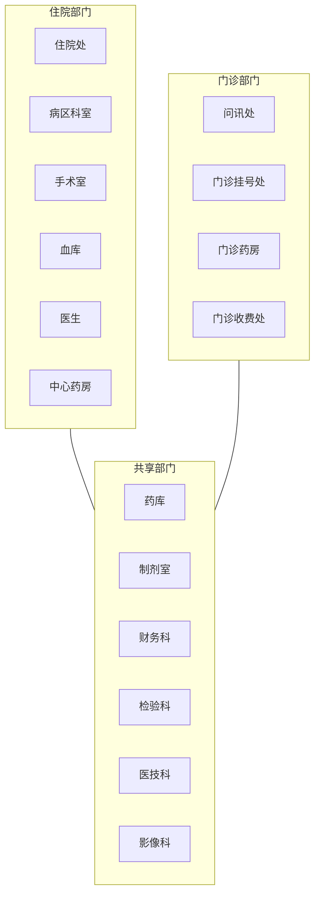

### 1.2 各部门的业务活动

**门诊部门**

首先，门诊病人需要到门诊挂号处挂号（如果病人有需要，可以对所要就诊的相应医科进行查询，可查询该医科的当班医生及其基本情况，然后再去挂号），如果是初诊病人要在门诊挂号处登记其基本信息，如姓名、年龄、住址、联系方式等，由挂号处根据病人所提供的信息制成IC卡发放给病人；然后，初诊病人可与复诊病人一样进行挂号和就诊排号，由挂号处处理病人的病历管理；

其次，病人需到门诊收费处缴纳挂号费，并持挂号和收费证明到相应医科就医，经医生诊疗后，由医生开出诊断结果或者处方，检查或检验申请单，如为处方，则病人需持处方单到门诊收费处划价交费，然后持收费证明到门诊药房取药；如为检查或检验申请单，则病人需持申请单到门诊收费处划价交费，然后持收费证明到检查科室或检验科室进行检查或检验；

当门诊药房接到取药处方后，要进行配药和发药，当药房库存的药品减少到一定量的时候，药房人员应到药库办理药品申领，领取所需的药品，而药房需对药品的出库、入库和库存进行管理；

当检查科室或检验科室接到病人的申请后，对病人进行检查或检验，并将检查或检验结果填入结果报告单，交给病人，各科室所做的检查或检验需记录在案。

病人可持检查或检验的结果再到原医科进行复诊，直至医生开出处方或提出医疗建议，最终病人痊愈离院。

**门诊部门业务流程图**

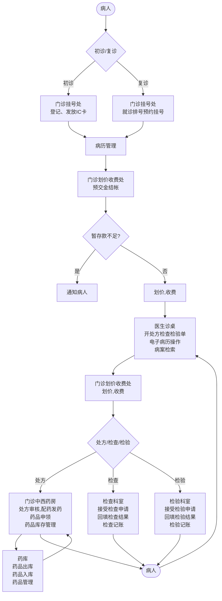

**住院部门**

当病人接到医生的建议需住院治疗或接到医院的入院通知单后，需到住院处办理入院手续，需要登记基本信息，并交纳一定数额的预交款或住院押金。住院手续办理妥当之后，由病区科室根据病人所就诊的医科给病人安排床位，将病人的预交款信息录入病进行相应的维护和管理，病区科室还应按照医生开出的医嘱执行，医嘱的主要内容包括病人的用药，检查申请或检验申请；

病区科室应将医嘱中病人用药的部分分类综合统计，形成药品申领单，统一向药库领药，然后将药品按时按量发给住院病人，需对发药情况进行记录，并对所领取的药品进行统一的管理；

病区科室应将医嘱中的检查或检验申请单发给检查科室或检验科室，当相应的科室将申请进行处理并将检查通知发给病区科室后，由病区科室通知病人进行相应的检查或检验；药库对于药品申领单的处理和对药品的管理，检查科室和检验科室对于申请、检查以及相应的管理工作与门诊中的部分相同；

当病人需要手术时，首先由病区科室将手术申请提交给手术室，由手术室安排手术日程，进行材料、器械的准备，当准备妥当后，手术室将手术通知发给病区科室，由病区科室通知并安排病人进入手术室，手术室需将手术中的麻醉记录，术中医嘱，材料、器械的使用记录在案；

当病人可以出院时，应先在病区科室进行出院登记，办理出科，然后在住院处办理出院手续，即可出院。当病人需要转科时，需在病区科室办理转科手续，转入另一病区，由另一病区的病区科室安排病人的床位，并对病人转入的相应资料进行管理。

**住院部门业务流程图**

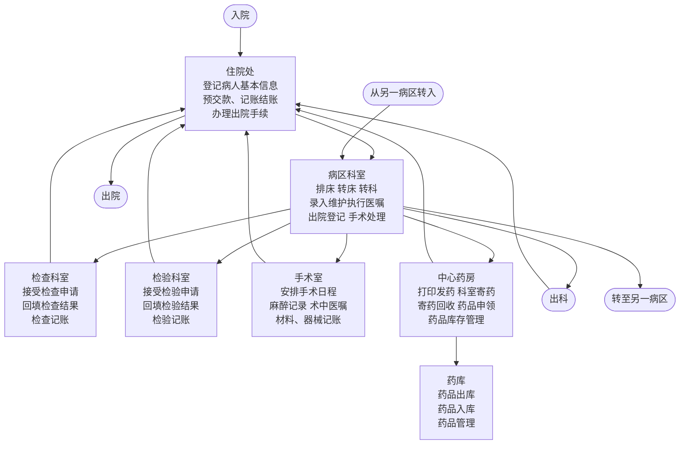

### 1.3 用户对系统的要求

**信息要求**

由于系统的使用主体是医院的管理人员，因此对系统的信息要求可分为以下几个方面：

* **病人信息**：首先是病人的基本信息，主要包括病人的姓名，性别，出生年月，年龄，家庭住址，联系方式等；对于门诊病人，还需要就诊时间，就诊医科，就诊结果，处方记录，检查时间，检查项目，检查结果，检验时间，检验项目，检验结果等；对于住院病人，还需要入院时间，所在病区，所在医科，床位号，主治医师，用药记录，检查时间，检查项目，检查结果，检验时间，检验项目，检验结果，手术时间，手术相关记录，病人病情变化记录，相关体检记录，出院时间等。
* **医生信息**：首先是医生的基本信息，主要包括医生的姓名，性别，出生年月，家庭住址，联系方式，医生的编码，所在医科，工龄，职称等；对于门诊医生，还需要挂号费用，当天工作量，出诊时间等；对于住院医生，还需要所在病区，负责病人，诊断记录等。
* **各种单据，证明的信息**：各种单据，证明，如医生诊断书，处方单，检验申请单，检查申请单，检验结果报告单，检查结果报告单，收款单，病人医疗记录，手术申请单，手术通知单，病人入院登记单，转科申请单，病人情况登记单，药品提领单，药品发放记录，药品出库单，药品入库单，设备使用记录，器械领用单，器械使用记录等。
* **各种库存信息**：各种库存，如药品、制剂、设备、器械以及后勤劳保用品等的信息，包括入库记录，出库记录，库存量，单价等；

**处理要求**

系统应当完成以下的信息处理：
* 存储病人信息，医生信息，各种单据、证明的信息，供相应的人员查询；
* 对病人信息进行及时的更新和统计；
* 对医生信息进行及时的更新和统计，并根据统计数字得出相关的其他数据，如根据医生的出诊情况、工龄、工作量、职称等，得出医生工资中相应的应得金额，完成对医生工资的计算和统计，供发放；
* 各种单据、证明以及记录，根据实际需要，进行更新，统计，自动处理，等等，如对病人病情的记录的及时更新，对药品提领情况的及时统计，通过系统，自动生成一些单证，如系统将手术申请单进行相应的处理，根据所存储的信息得出相关信息，如手术可进行时间，手术室地点安排等，进而生成手术通知单；
* 对各种库存信息的及时更新和统计以及相关的自动处理，系统应根据库存量，入库量，出库量，自动得出新的即时的库存量，完成更新，当库存少到一定程度，系统应提出警告，提示管理人员库存不足，使管理人员做出相应的处理；
* 所有原始数据和统计数据进行相关分析，如门诊收入，住院收入，药品收支，物资情况，医疗信息，病区床位利用率，床位周转率等；
* 对医院所需的各种报表，图形显示，分析报告，各种单据进行打印，以供相关的使用。

**安全性要求**

* 系统应设置访问用户的标识以鉴别是否是合法用户，并要求合法用户设置其密码，保证用户身份不被盗用；
* 系统应对不同的数据设置不同的访问级别，限制访问用户可查询和处理数据的类别和内容；
* 系统应对不同用户设置不同的权限，区分不同的用户，如区分病人（只能查询医生的出诊情况，医科设置，医生简介和本人的信息），医生（只能查询本医科诊治的病人资料，本人的信息，医院的公共信息等），管理人员（可查询医院相关的运作情况，并可根据其工作内容，录入相关的信息，修改相关的记录），系统管理员（可对系统进行日常维护，包括数据更新，权限设置等），院长（可查询医院所有运作情况（包括医院的医疗管理、经济管理、行政管理等）的数据，医生的信息，以及各种统计和分析结果等）。

**完整性要求**

* 各种信息记录的完整性，信息记录内容不能为空；
* 各种数据间相互的联系的正确性；
* 相同的数据在不同记录中的一致性。

### 1.4 确定系统的边界

经对前面的需求调查和初步的分析，确定由计算机完成的工作时对数据进行各种管理和处理，具体的工作内容见第二部分， 由手工完成的工作主要有对原始数据的录入；不能由计算机生成的，各种数据的更新，包括数据变化后的修改，数据的增加，失效数据或无用数据的删除等；以及系统的日常维护。

## 第 2 章 系统功能设计

根据如上得到的用户需求，我们将本系统按照所完成的功能分成以下几个子系统：门诊管理子系统、药品管理子系统、住院管理子系统、行政管理子系统。

各子系统完成的功能如下：

### 2.1 门诊管理子系统

* **门诊挂号部分**
    * 处理门诊病人挂号事务；
    * 支持多种挂号类别以及自费、公费、记账等多种挂号病人，支持退号操作；
    * 向首次来院就诊的病人发放就医IC卡，登记病人基本信息；
    * 建立、维护门诊病历的基本信息。
* **门诊收费部分**
    * 输入门诊病人的处方和各种诊疗项目，由电脑自动划价，同时对指定的项目支持手工划价；
    * 收费后，处方信息自动发送到门诊药房；检查、检验项目发送到相应医技科室；
    * 具有处方的作废、退费功能；
    * 办理持就医IC卡病人的交款、退款和结账手续；
    * 查询病人费用明细；
    * 查询统计：收款员缴款报表、收入分类报表；全院收入报表、收入分类报表；临床科室收入、工作量报表；医生收入、工作量报表；医技科室收入、工作量报表。

### 2.2 药品管理子系统

* **门诊药房管理部分**
    * 接收门诊收费处或门诊医生工作站发送来的处方，按处方内容备药、发药；
    * 向药库提交药品请领单，以从药库领药为入库，处方发药为出库，实现门诊药房的出入库管理；
    * 药品盘点、报损处理；
    * 持就医IC卡的病人可在此刷卡扣除药费并取药；
    * 统计门诊药房配、发药人员工作量；
    * 统计各科室、全院门诊药品消耗量；
    * 查询病人处方内容；
* **中心药房部分**
    * 接收病区发送来的处方，生成病区领药单以进行配药、发药；
    * 向药库提交药品请领单，以从药库领药为入库，病区领药为出库，实现药房的库存管理；
    * 药品的盘点、报损处理；
    * 对病区的余药进行回收管理；
    * 为病区实时提供医嘱药品的库存信息；
    * 统计药房配、发药人员工作量；
    * 统计各科室、全院药品消耗量；
* **药库部分**
    * 建立药库的药品出入库账目；
    * 辅助制定合理的药品库存水平和采购计划，以最小的资金占用保证药品的供应；
    * 按药品批次和有效期进行管理和出库安排；
    * 通过与门诊药房和中心药房的连接，实现药库药品出库与各药房药品入库的计算机一体化处理；
    * 进行药品的调价、盘点、报损处理；
    * 药品入、出、存的查询统计。

### 2.3 住院管理子系统

* **住院收费处部分**
    * 住院病人办理入出院、交退款、记账、结账等手续；
    * 冲账功能；
    * 形成住院部的收入日结算；
    * 将出院病人的信息传送至病案管理模块；
    * 统计收款员缴款报表、收入分类报表，全院收入报表、收入分类报表，临床科室收入、工作量报表，医生收入、工作量报表，医技科室收入、工作量报表；
* **病区管理部分**
    * 完成病人的入、出、转登记；
    * 管理病区床位，提供换床、挂床、包床处理；
    * 录入、维护或执行和各类长短期医嘱；
    * 根据用药类医嘱自动生成处方并划价记账，发送至中心药房申领药品；
    * 向检查科室提交检查申请；向检验科室提交检验申请；向手术室提交手术申请；
    * 对于病人在病区发生的床费等各项常规费用进行及时记账；
    * 自动采集用药相关费用，如注射费、注射器费、滴管费等；
    * 录入病人体征信息、诊断信息；
    * 可以设置预交金报警下限，对病人账目实时监控，余额不足时自动提示，避免欠费的发生；
    * 公布病人每日用款情况；
    * 输出各种护理工作单：治疗单、服药单、肌注单、滴注单等；

### 2.4 门诊管理子系统与住院管理子系统交叉的部分

* **检查科室部分**
    * 接收门诊或病区发送来的检查申请，安排检查日程；
    * 辅助医生填写检查结果或书写检查报告，提供各类报告的模板和常用术语字典；
    * 将检查结果返回申请科室；
    * 对于住院病人将检查费用记账，持IC卡病人可在此刷卡扣除检查费；
    * 对检查结果进行统计分析；
    * 查询检查科室的收入、工作量等信息；
* **检验科室部分**
    * 接收门诊或病区发送来的检验申请；
    * 检查完成后，通过联机数据采集或手工录入结果，将检验结果形成报告，传回申请科室，对于住院病人将检验费用记账，持IC卡病人可在此刷卡扣除检查费；
    * 对检验结果进行统计分析；
    * 查询检验科室的收入、工作量等信息；
* **病案管理和工作量统计部分**
    * 接收住院处传来的出院病人信息；
    * 对于一个病人多个病案号的情况，提供了病案号合并功能；
    * 对病案的流通进行跟踪管理；
    * 提供多种条件任意组合模糊查询；
    * 提供多种医院及上级管理部门所需报表格式；
    * 首创病案数据变量多条件组合分析，提供多种医学统计分析指标，数据分析图表等功能；
    * 对医院的诊疗工作量进行输入、查询和统计。

### 2.5 行政管理子系统

* 提供多种条件的，对医院各方面运作的查询；
* 根据各方面的数字，形成一定的分析，其结果作为辅助医院行政管理人员做出决策的部分依据；
* 供医院所有工作人员的详细资料的综合管理；
* 提供医院所有工作人员的工资管理和核算；
* 提供对医院的医疗管理、经济管理、行政管理等方面信息的各种查询和统计、分析，提供报表打印和图形显示，可供医院领导进行综合查询，做辅助决策之用。

经上述分析，我们已经得到了对于该系统的基本要求和系统模块的划分，在这些模块中，我们选择门诊管理子系统，住院管理子系统，药品管理子系统 (其中，对前两个系统进行了重点设计) 进行具体的数据库设计。

## 第 3 章 数据流图

在需求分析中形成的数据流图如下：

### 3.1 门诊管理子系统

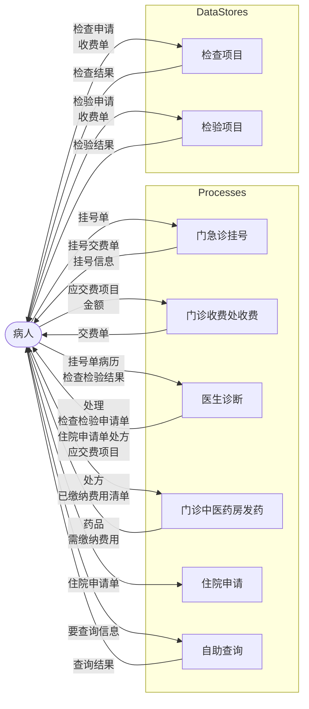

### 3.2 病房管理子系统

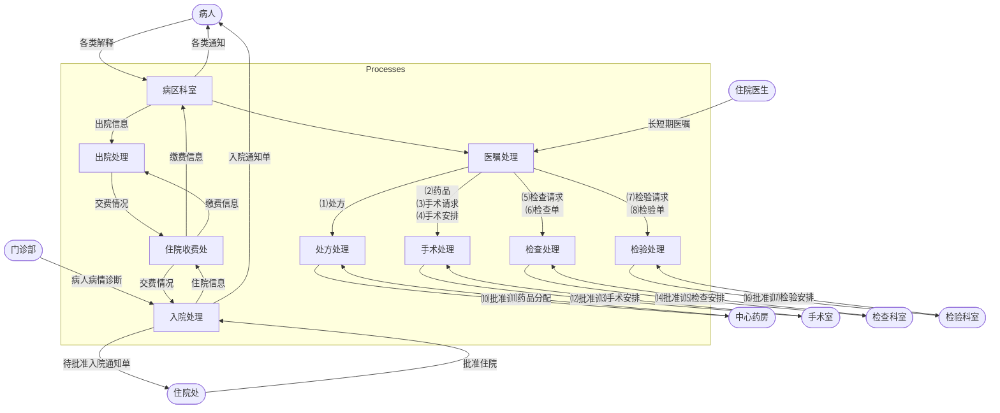

注:
⑴ 处方 ⑵ 药品 ⑶ 手术请求 ⑷ 手术安排 ⑸ 检查请求 ⑹ 检查单 ⑺ 检验请求 ⑻ 检验单 ⑼ 出院通知 ⑽ 批准请求 ⑾ 药品分配 ⑿ 批准请求 ⒀ 手术安排 ⒁ 批准请求 ⒂ 检查安排 ⒃ 批准请求 ⒄ 检验安排

### 3.3 药品管理子系统

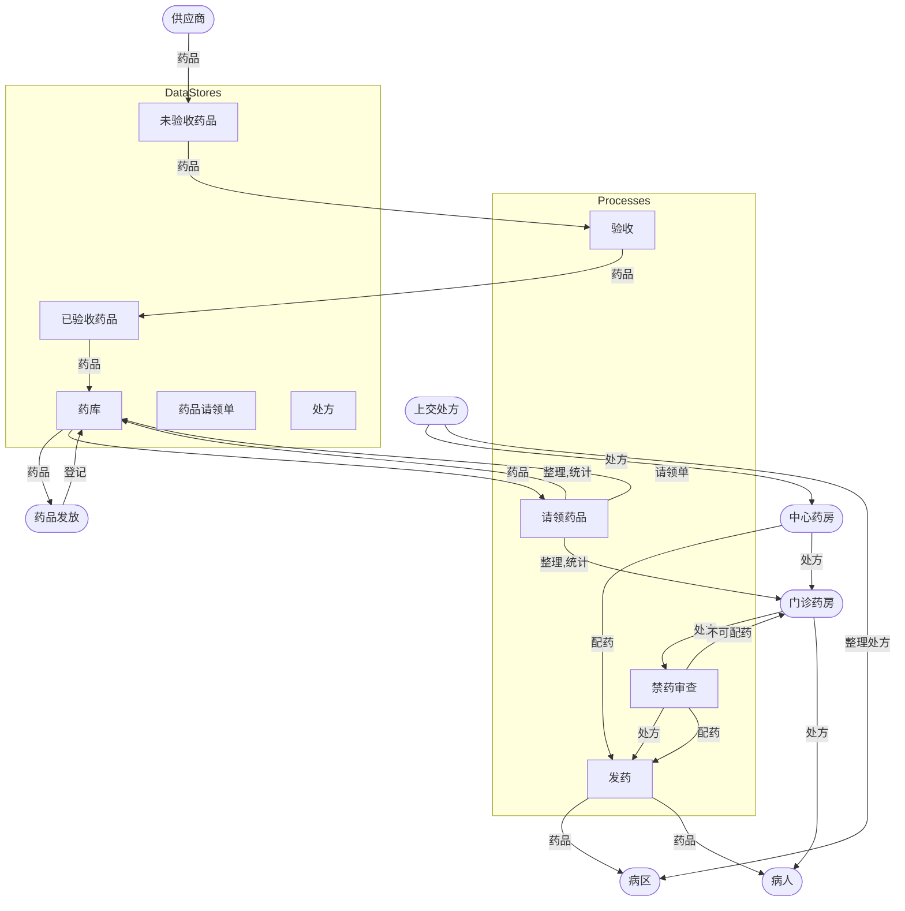

## 第 4 章 数据字典

医院信息系统各实体及联系数据字典（注：重复的则后面涉及时不再在备注中列出，意思很明确的也不再备注）：

### 4.1 挂号单数据字典

| 属性名 | 存储代码 | 类型 | 长度 | 备注 |
| :--- | :--- | :--- | :--- | :--- |
| 挂号号 | Gh_no | String | 8 | 挂号单的序列号 |
| 挂号类别 | Ghlb | String | 20 | 病人所看医科 |
| 主治医师 | zzys | String | 20 | 主治医师姓名 |
| 挂号人姓名 | ghrxm | String | 20 | 病人姓名 |
| 挂号科室 | ghks | String | 20 | 内外科等 |
| 挂号日期 | Gh_date | String | 20 | 病人挂号日期 |

### 4.2 处理方案数据字典

| 属性名 | 存储代码 | 类型 | 长度 | 备注 |
| :--- | :--- | :--- | :--- | :--- |
| 处理方案号 | Clfa_no | Int | 8 | |
| 医师号 | Ys_no | String | 8 | 医生号码 |
| 开出时间 | Kc_date | String | 20 | |
| 处理方案内容 | Clfa_con | String | 100 | |

### 4.3 门诊病历数据字典

| 属性名 | 存储代码 | 类型 | 长度 | 备注 |
| :--- | :--- | :--- | :--- | :--- |
| 病历号 | Bl_no | String | 8 | 病人病号序列 |
| 病人姓名 | Br_name | String | 20 | |
| 主治医师 | Zzys_name | String | 20 | 主治医师姓名 |
| 诊断时间 | Zd_date | String | 20 | 病人看病时间 |
| 病历内容 | Bl_con | String | 100 | 病人病历情况 |

### 4.4 门诊处方数据字典

| 属性名 | 存储代码 | 类型 | 长度 | 备注 |
| :--- | :--- | :--- | :--- | :--- |
| 处方号 | Cf_no | Int | 8 | 处方序列号 |
| 主治医师 | zzys | String | 20 | 主治医师姓名 |
| 病人姓名 | Br_name | String | 20 | |
| 病人性别 | Br_sex | Char | 2 | |
| 病人年龄 | Br_age | Int | 8 | |
| 处方内容 | Cf_con | String | 100 | 病人处方内容 |

### 4.5 收费项目数据字典

| 属性名 | 存储代码 | 类型 | 长度 | 备注 |
| :--- | :--- | :--- | :--- | :--- |
| 收费项目号 | Sfxm_no | Int | 8 | 收费项目序列号 |
| 挂号费 | Gh_fee | Real | 10 | 挂号花费费用 |
| 药品费 | Yp_fee | Real | 10 | 药品花费费用 |
| 检查费 | Jc_fee | Real | 10 | 检查花费费用 |
| 检验费 | Jy_fee | Real | 10 | 检验花费费用 |

### 4.6 门诊医师数据字典

| 属性名 | 存储代码 | 类型 | 长度 | 备注 |
| :--- | :--- | :--- | :--- | :--- |
| 医师号 | Ys_no | String | 8 | 门诊医师序列号 |
| 科室 | Ks | String | 10 | 医师所属科室名 |
| 当值日期 | Dz_date | String | 20 | 医师值班日期 |

### 4.7 门诊病人数据字典

| 属性名 | 存储代码 | 类型 | 长度 | 备注 |
| :--- | :--- | :--- | :--- | :--- |
| 姓名 | Name | String | 20 | 门诊病人姓名 |
| 年龄 | Age | Int | 8 | |
| 性别 | Sex | Char | 1 | |
| 就诊时间 | Jz_date | String | 20 | |
| 交费情况 | jfqk | String | 10 | 病人就诊花费 |

### 4.8 检验项目数据字典

| 属性名 | 存储代码 | 类型 | 长度 | 备注 |
| :--- | :--- | :--- | :--- | :--- |
| 检验序号 | Jy_no | Int | 8 | 病人检验序列号 |
| 检验医师 | Jyys | String | 20 | 检验医师序列号 |
| 检验时间安排 | Jy_date | String | 20 | |
| 检验内容 | Jy_con | String | 100 | |
| 检验分析 | Jyfx | String | 100 | 病人检验结果分析 |
| 检验结果 | Jyjg | String | 100 | |
| 检验收费情况 | Jy_fee | Real | 10 | |

### 4.9 检查项目数据字典

| 属性名 | 存储代码 | 类型 | 长度 | 备注 |
| :--- | :--- | :--- | :--- | :--- |
| 检查序号 | Jc_no | Int | 8 | 病人检查序列号 |
| 检查医师 | Jcys | String | 20 | 检查医师姓名 |
| 检查时间安排 | Jc_date | String | 20 | |
| 检查内容 | Jc_con | String | 100 | |
| 检查分析 | Jcfx | String | 100 | 病人检查结果分析 |
| 检查结果 | Jcjg | String | 100 | |
| 检查收费情况 | Jc_fee | Real | 10 | |

### 4.10 工作时间安排数据字典

| 属性名 | 存储代码 | 类型 | 长度 | 备注 |
| :--- | :--- | :--- | :--- | :--- |
| 工作时间 | Gz_date | String | 20 | 门诊部门上班时间 |
| 科室 | ks | String | 10 | 门诊所属科室名 |
| 事假情况 | Sjqk | String | 50 | 工作人员事假情况 |
| 病假情况 | Bjqk | String | 50 | 工作人员病假情况 |

### 4.11 供应商数据字典

| 属性名 | 存储代码 | 类型 | 长度 | 备注 |
| :--- | :--- | :--- | :--- | :--- |
| 供应商号 | Trader_no | String | 8 | 药品供应商号 |
| 地址 | Add | String | 30 | 药品供应商地址 |
| 电话 | Tel | String | 15 | |
| 信贷状况 | Xdzk | Char | 1 | “优“、“良”、“差” |

### 4.12 订单数据字典

| 属性名 | 存储代码 | 类型 | 长度 | 备注 |
| :--- | :--- | :--- | :--- | :--- |
| 订单号 | Dd_no | String | 20 | 药品购买订单号 |
| 供应商号 | Trader_no | Int | 8 | |
| 订货项数 | Goods_no | Int | 8 | 购买药品订货项数 |
| 订货日期 | Dgoods_date | String | 20 | |
| 交货日期 | Jgoods_date | String | 20 | |
| 生产地点 | Pru_add | String | 20 | |

### 4.13 药品数据字典

| 属性名 | 存储代码 | 类型 | 长度 | 备注 |
| :--- | :--- | :--- | :--- | :--- |
| 药品编号 | Kind_no | String | 8 | 药库存药编号 |
| 品名 | Drug_name | String | 20 | 药库存药名称 |
| 规格 | Guige | String | 20 | |
| 单位 | Dw | String | 40 | 药品计量单位 |
| 数量 | Num | Int | 8 | |
| 单价 | Ind_price | Real | 20 | 药品单价 |
| 金额 | Tol_price | Real | 20 | 购买药品总金额 |
| 生产日期 | Gen_date | String | 20 | 药品的生产日期 |
| 保质期 | Pz_date | String | 20 | 药品的保质期 |

### 4.14 药库数据字典

| 属性名 | 存储代码 | 类型 | 长度 | 备注 |
| :--- | :--- | :--- | :--- | :--- |
| 药库号 | Yk_no | Int | 8 | 存药仓库序号 |
| 负责人 | Mng_no | String | 20 | 药库保管员负责人名字 |
| 类别 | Kind | String | 20 | 药库的类别 |
| 面积 | Area | Real | 20 | 药库的面积 |

### 4.15 订单细则

| 属性名 | 存储代码 | 类型 | 长度 | 备注 |
| :--- | :--- | :--- | :--- | :--- |
| 订单号 | Dd_no | String | 20 | |
| 细则号 | Sz_no | Int | 8 | 订单细则序号 |
| 药品编号 | Kind_no | Int | 8 | 药品的编号 |
| 单价 | Ind_price | Real | 20 | 药品单价 |
| 数量 | Num | Int | 8 | 购买药品数量 |
| 规格 | Guige | String | 20 | |
| 金额 | Tol_price | Real | 20 | 购买药品总金额 |
| 批号 | P_no | String | 8 | 此类药品的准批号 |

### 4.16 药品请领单

| 属性名 | 存储代码 | 类型 | 长度 | 备注 |
| :--- | :--- | :--- | :--- | :--- |
| 编号 | B_no | Int | 8 | 药品请领单序号 |
| 药库号 | Yk_no | Int | 8 | 请领药品所属仓库号 |
| 领用单位 | Lydw | String | 20 | 领用药品单位名称 |
| 药品名称 | Drug_name | String | 20 | 领用药品名称 |
| 规格 | Guige | String | 20 | |
| 领药量 | Lyl | Real | 20 | |
| 单价 | Ind_price | Real | 20 | |
| 金额 | Tol_price | Real | 20 | |

### 4.17 收费项目

| 属性名 | 存储代码 | 类型 | 长度 | 备注 |
| :--- | :--- | :--- | :--- | :--- |
| 项目列号 | Term_no | Int | 8 | 收费所属项目序号 |
| 项目类型 | Term_con | String | 20 | |
| 收费类型 | Fee_ty | String | 8 | |
| 收费金额 | Sfje | Real | 20 | |
| 收款员 | Sku | String | 20 | 收费工作员名字 |
| 结账情况 | Jzqk | String | 20 | 是否结清 |
| 结账金额 | Jzje | Real | 20 | |
| 是否转账 | Sfzz | Bool | 1 | “是“、“否” |
| 病人姓名 | Brxm | String | 20 | 交费病人姓名 |

### 4.18 医嘱

| 属性名 | 存储代码 | 类型 | 长度 | 备注 |
| :--- | :--- | :--- | :--- | :--- |
| 诊断单序号 | Zddxh | Int | 8 | 病情诊断单序列号 |
| 诊断类别 | Zdlb | String | 8 | 诊断所属科目 |
| 启用日期 | Qyrq | Date | 10 | 医嘱生成日期 |
| 处理日期 | Clrq | Date | 10 | 医嘱有效期 |
| 医嘱内容 | Yznr | String | 50 | |
| 主治医师姓名 | Zzysxm | String | 10 | 开出医嘱医师姓名 |
| 病人姓名 | Brxm | String | 10 | |
| 疾病编码 | Jbbm | Int | 8 | |
| 疾病名称 | Jbmc | String | 20 | |
| 出院转归 | Cyzg | String | 8 | “是”、“否” |

### 4.19 住院处方

| 属性名 | 存储代码 | 类型 | 长度 | 备注 |
| :--- | :--- | :--- | :--- | :--- |
| 处方号 | Cfh | Int | 8 | 住院病人处方号 |
| 诊断单序号 | Zddxh | Int | 8 | |
| 处方内容 | Cfnr | String | 100 | |
| 主治医师号 | Zzys | String | 10 | |
| 病人姓名 | Brxm | String | 10 | |
| 附注 | Fz | String | 50 | 住院其它注意项 |

### 4.20 检查项目

| 属性名 | 存储代码 | 类型 | 长度 | 备注 |
| :--- | :--- | :--- | :--- | :--- |
| 检查序号 | Jcxh | Int | 8 | 检查科目序号 |
| 检查日期安排 | Jcrqap | String | 20 | |
| 检查负责人员 | Jcfzry | String | 10 | 负责人姓名 |
| 住院号 | Zyh | Int | 8 | 病人住院序号 |
| 检查内容 | Jcnr | String | 50 | |
| 检查结果 | Jcjg | String | 100 | |

### 4.21 检验项目

| 属性名 | 存储代码 | 类型 | 长度 | 备注 |
| :--- | :--- | :--- | :--- | :--- |
| 检验序号 | Jysh | Int | 8 | 检验科目序号 |
| 检验日期安排 | Jyrqap | String | 20 | |
| 检验负责人员 | Jyfzry | String | 10 | 负责人姓名 |
| 住院号 | Zyh | Int | 8 | 病人住院序号 |
| 检验内容 | Jynr | String | 50 | |
| 检验结果 | Jyjg | String | 100 | |

### 4.22 手术

| 属性名 | 存储代码 | 类型 | 长度 | 备注 |
| :--- | :--- | :--- | :--- | :--- |
| 手术序号 | Ssxh | Int | 8 | |
| 主刀医师号 | Zdysh | String | 10 | |
| 住院号 | Zyh | Int | 8 | 病人住院序列号 |
| 病人姓名 | Brxm | String | 10 | |
| 手术名称 | Ssmc | String | 20 | |
| 麻醉方式 | Mzfs | String | 8 | 全身或局部 |
| 切口情况 | Qkqk | String | 8 | 手术部位伤口状况 |
| 手术日期 | Ssrq | Date | 10 | |
| 手术持续时间 | Sscxsj | Time | 10 | |
| 手术结果 | Ssjg | String | 50 | 是否成功 |
| 手术室号 | Sssh | Int | 10 | 手术室序号 |

### 4.23 住院病人

| 属性名 | 存储代码 | 类型 | 长度 | 备注 |
| :--- | :--- | :--- | :--- | :--- |
| 住院号 | Zyh | Int | 8 | |
| 病人姓名 | Brxm | String | 10 | |
| 床位号 | Cwh | Int | 8 | |
| 入院科别 | Rykb | String | 8 | |
| 入院时间 | Rysj | Date | 10 | |
| 入院情况 | Ryqk | string | 4 | |
| 转科情况 | Zkqk | String | 8 | 是否转科 |
| 出院科别 | Cykb | String | 8 | |

### 4.24 住院医师

| 属性名 | 存储代码 | 类型 | 长度 | 备注 |
| :--- | :--- | :--- | :--- | :--- |
| 医师号 | Ysh | Int | 8 | |
| 医师姓名 | Ysxm | String | 10 | |
| 所属科室 | Ssks | String | 8 | 医师所属科室名 |
| 是否当值 | Sfdz | Bool | 1 | “是”、“否” |
| 工作量 | Gzl | Real | 8 | |

### 4.25 床位

| 属性名 | 存储代码 | 类型 | 长度 | 备注 |
| :--- | :--- | :--- | :--- | :--- |
| 住院号 | Zyh | Int | 8 | |
| 姓名 | Xm | String | 10 | 住本床位病人姓名 |
| 床号 | Ch | Int | 8 | 床位序号 |
| 主管医师 | Zgys | String | 8 | 主管本床位医师名字 |
| 值班人员号码 | Zbryhm | Int | 8 | |
| 治疗结果 | Zljg | String | 20 | |
| 所属病区 | ssbq | Int | 8 | 本床位所属病区 |
| 是否空床 | Sfkc | Bool | 1 | “是”、“否” |
| 床位租金 | Cwzj | Real | 8 | 床位租金费用 |

### 4.26 病区

| 属性名 | 存储代码 | 类型 | 长度 | 备注 |
| :--- | :--- | :--- | :--- | :--- |
| 病区名 | Bqm | String | 10 | |
| 床位数 | Cws | Int | 8 | 所属病区床位总数 |
| 负责人 | Fzr | String | 10 | 病区负责人姓名 |
| 入住人数 | Rzrs | Int | 8 | 病区入住病人总人数 |
| 出院人数 | Zyrs | Int | 8 | |
| 治疗率 | Zll | Real | 4 | 入住本病区病人治愈程度 |
| 好转率 | Hzl | Real | 4 | |
| 未愈率 | Wyl | Real | 4 | |
| 死亡率 | Swl | Real | 4 | |
| 诊断符合 | Zdfh | Bool | 2 | “是”、“否” |
| 床位使用率 | Cwsyl | Real | 4 | 病区床位的使用情况 |

### 4.27 医师情况

| 属性名 | 存储代码 | 类型 | 长度 | 备注 |
| :--- | :--- | :--- | :--- | :--- |
| 姓名 | name | string | 20 | |
| 专业技术职称 | zyjszc | String | 10 | 医师技术职称 |
| 文号 | wh | int | 8 | |
| 日期 | Rq | date | 20 | |
| 备注 | Bz | string | 50 | |

### 4.28 病人情况

| 属性名 | 存储代码 | 类型 | 长度 | 备注 |
| :--- | :--- | :--- | :--- | :--- |
| 姓名 | name | string | 20 | |
| 性别 | Sex | char | 1 | |
| 出生日期 | Cs_date | date | 20 | |
| 年龄 | age | Date | 20 | |
| 婚姻状况 | hyzk | string | 100 | |
| 职业 | zy | string | 10 | |
| 出生地 | csd | string | 20 | |
| 民族 | md | string | 10 | |
| 身份证号 | sfzh | long | 20 | |
| 国籍 | gj | string | 10 | |
| 工作 | gz | string | 10 | |
| 单位及地址 | dwjdz | string | 20 | |
| 电话 | Tel | stirng | 20 | |
| 邮政编码 | yzbm | long | 10 | |
| 户口地址 | hkdz | stirng | 50 | |
| 联系人姓名 | lxrxm | string | 20 | |
| 联系人地址 | lxrdz | string | 20 | |
| 联系人关系 | lxrgx | string | 20 | |
| 联系人电话 | lxrdh | string | 20 | |
| 是否住院 | sfzy | bool | 4 | |

### 4.29 病案

| 属性名 | 存储代码 | 类型 | 长度 | 备注 |
| :--- | :--- | :--- | :--- | :--- |
| 病案号 | bah | Int | 8 | 备份病案序号 |
| 病人 | br | string | 20 | 病人名字 |
| 入院科室 | ryks | string | 20 | |
| 病室 | bs | string | 20 | 病人所属病室号 |
| 入院日期 | ryrq | date | 20 | |
| 入院诊断 | ryzd | string | 50 | |
| 入院情况 | ryqk | char | 1 | 危,急,一般 |
| 转科情况 | zkqk | string | 20 | |
| 出院科别 | cykb | string | 20 | |
| 出院病室 | cybs | string | 20 | |
| 出院时间 | cysj | time | 20 | |
| 出院诊断 | cyzd | string | 20 | |
| 入院确诊日期 | ryqzrq | Time | 20 | |
| 出院情况 | cyqk | string | 50 | |

# 第二篇 概念结构设计

## 第 5 章 门诊子系统

根据需求分析中画出的门诊子系统的第一层数据流图，可以看出在医院门诊中一切活动都是以病人为核心，而各种处理也是由病人主动去完成，如挂号、检查、检验、交费、取药、看病、做检查检验等。在整个数据流图中病人处于核心地位，而医院门诊的各个职能部门则完成相应的数据处理操作，如在门急诊挂号处完成。

在需求分析中我们从分析门诊部门的行政结构入手，我们得出门诊子系统存在着5个方面的需求，可以划分为5个次级子系统，从而可以设计出5个概念模式，为下一步的概念结构设计打好基础，这五个概念模式为：病人自助查询，门急诊挂号，门诊收费，中西药房和医生诊桌子系统。

**门诊子系统概念结构**

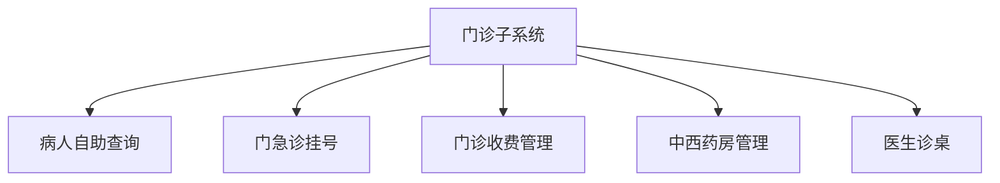

以门诊子系统的第一层数据流图为基础，接下来对于各个稍微复杂的处理过程进行细化，画出其具体数据流图，从而抽象出E-R图，为进一步的逻辑设计打下基础。而在本子系统的第一层数据流图中，检查项目处理和检验项目处理的数据比较简单，可以很简单的找出其关系表，不再进行细化分析。另外5个处理过程的具体数据流图如下；

### 5.1 分数据流图分析

#### 5.1.1 自助查询

本子系统是用于不熟悉的病人进行查询之用，可进行科室查询、医生查询和挂号科室查询等。查询中需要的信息有很多，但是并非所有的都需要用数据库查询来完成，对于医院概况、建筑物布局和名称等数据并不需要用数据库来完成，而对于医生资料信息以及当天的当值情况等数据则需要由数据库来完成。类似这里有两个常用的查询：(a)某医科有哪些当值医生;(b)查询某医生是否当值以及其简要资料。

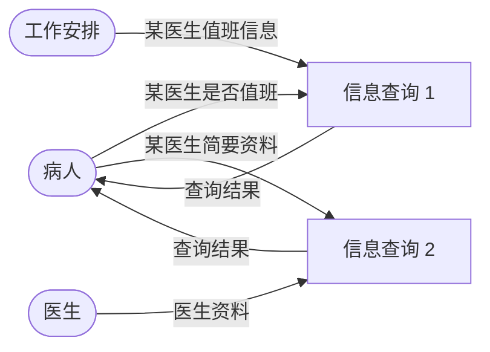

#### 5.1.2 挂号处理

病人在已获知挂号信息（挂什么科室，什么医生等）的情况下进行挂号(病人拥有IC卡，则在数据意义上表示医院存在该病人的基础信息)

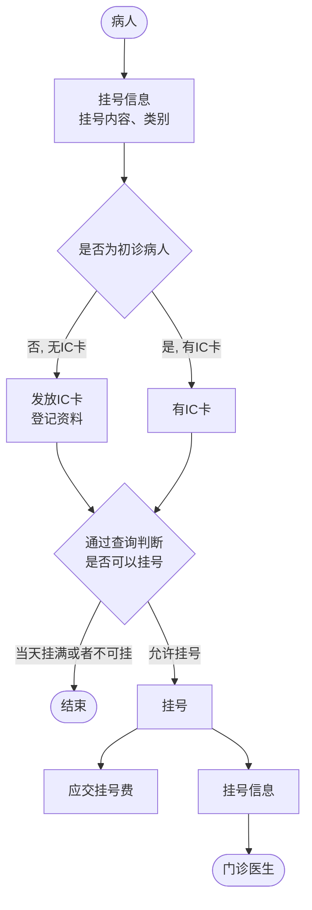

#### 5.1.3 门诊中西药房发药

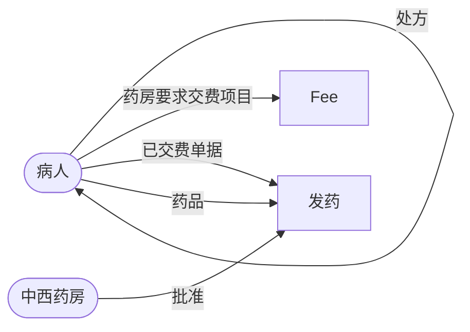

#### 5.1.4 门诊收费处收费

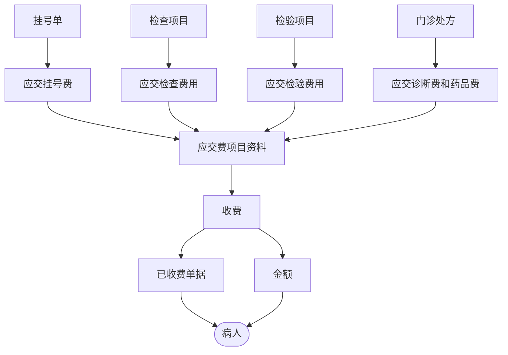

#### 5.1.5 医生诊断

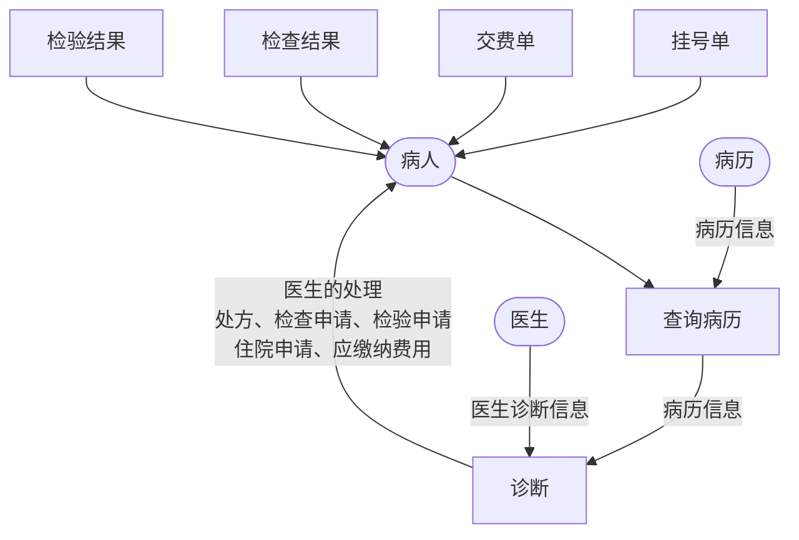

### 5.2 各个分数据流图的E—R图

#### 5.2.1 自助查询

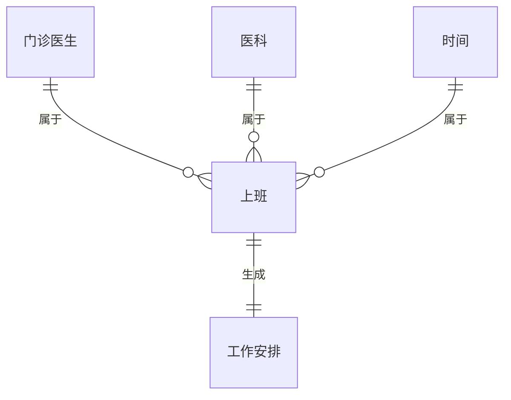

#### 5.2.2 挂号处理

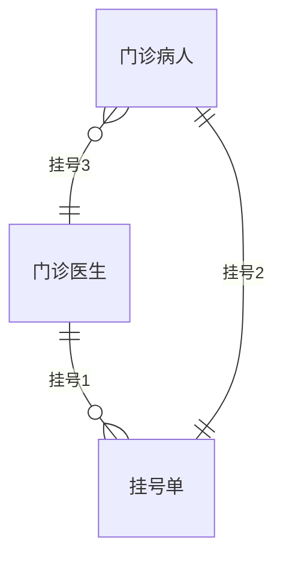

#### 5.2.3 门诊中西药房发药

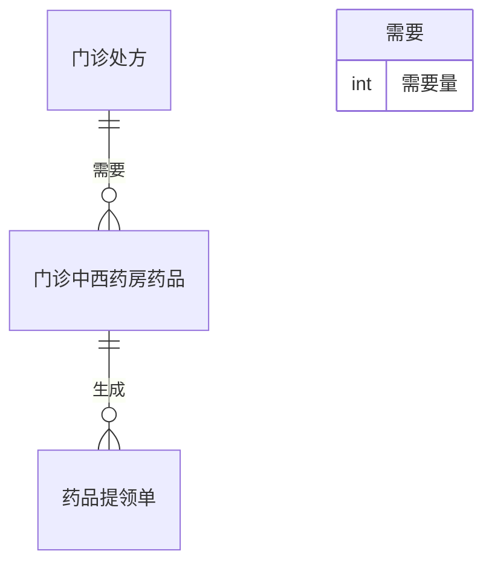

#### 5.2.4 门诊收费处收费

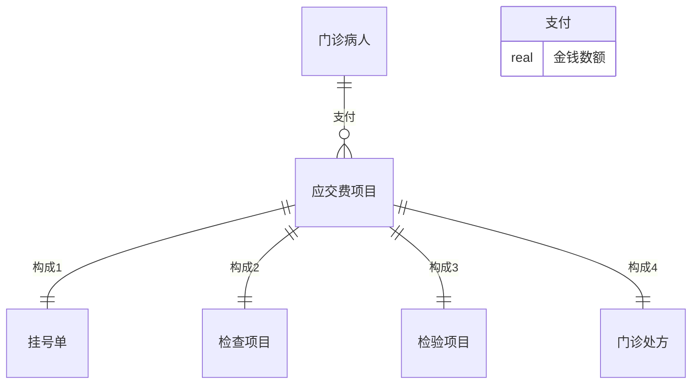

#### 5.2.5 医生诊断

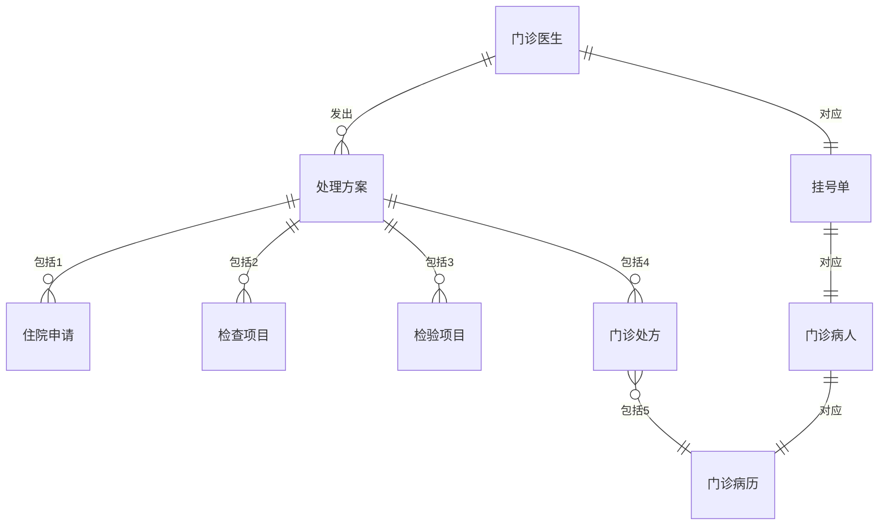

### 5.3 门诊子系统总E-R图

#### 5.3.1 总E-R图

根据上面的分E-R图和门诊子系统的第一层数据流图画出总的E-R图。由于篇幅的问题，不再画出各个实体与其属性的E-R分图，各个实体及其属性可以参看下面列出的说明。

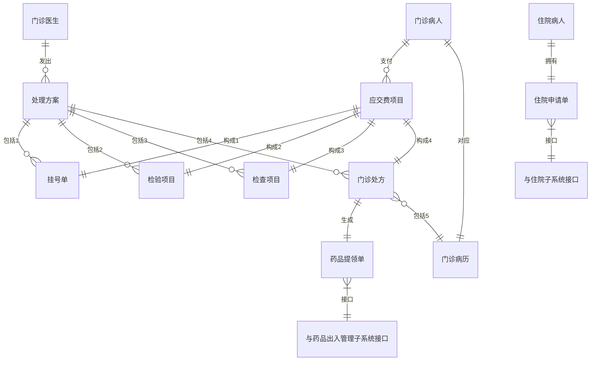

**实体及相应的属性**

* **门诊医师**: (医师号, 科室、工作时间,姓名,专业技术职称,性别,出生日期,年龄,婚姻状况,职业,出生地,民族,身份证号,国籍,住址,电话,邮政编码,户口地址, 备注)
* **挂号单**: (挂号号、挂号类别、挂号日期、挂号科室、主治医师、病人姓名)
* **处理方案**: （处理方案号、开出时间、处理方案内容、主治医师，病人姓名）
* **门诊病历**: （病历号、病人姓名、病历内容、诊断时间、主治医师）
* **处方**: （处方号、处方内容、主治医师、病人姓名、病人性别、病人年龄、附注）
* **收费项目**: （收费项目号、项目类型、相应序号、收费金额、收费人员、病人姓名）
* **门诊病人**: (病人号,姓名,性别,出生日期,年龄,婚姻状况,职业,出生地,民族,身份证号,国籍,工作单位及地址,电话,邮政编码,户口地址,联系人姓名,联系人地址,联系人关系，是否住院, 联系人电话)
* **检验项目**: （检验序号、检验医师、检验时间安排、检验内容、检验分析、检验结果，检验收费情况）
* **检查项目**: （检查序号、检查医师、检查时间安排、检查内容、检查分析、检查结果、检查收费情况）
* **工作时间安排**: （工作时间、所属科室、主治医师）

**联系说明及其相应属性**
* 支付：（支付金额、支付时间、支付项目）
* 生成（门诊处方－药品提领单）：这里做了简化(少了分E-R图中的中西药房药品实体及相关联系)，直接由门诊处方与药品提领单产生联系，原因是为了简化设计。
* 包括1、包括2、包括3、包括4（医生处理方案与具体处理方案的联系，不需要属性）
* 包括5（门诊处方－门诊病历）
* 发出（门诊医生－处理方案）
* 对应（门诊病人－门诊病历）

## 第 6 章 住院子系统

住院子系统是病人在接受到入院通知单或紧急入院后所能接触的系统。在需求分析部分,我们已经得出了总的数据流图,在此,将此对之进行进一步细化将有利于画出相应的E-R图。

经过分析,认为住院系统的具体流程如下:
病人持入院通知书,在住院收费处缴纳押金后分配床位;医生对病人做出诊断,开出医嘱;医嘱分类,然后根据处方提药、根据检查项目检查、根据检验项目检验、根据手术项目手术,同时相应进行收费登记;痊愈后病人持出院通知书出院,进行收费结算。

因此可将之划为以下几块:

根据需求分析中的总数据流图,可将之分为以下几个下一级的数据流图:

1.  **病人入院**
    流程解释:入住时病人持门诊所开出的入院通知书,到住院收费处缴纳押金,持其开出的票据办理入院手续,登记病区、床位。根据此数据流图和已得出的数据字典,可知，此分子系统的功能主要围绕着"病人"、"入院通知单"、"床位"、"病区"展开。因此,得到以下的E-R图:

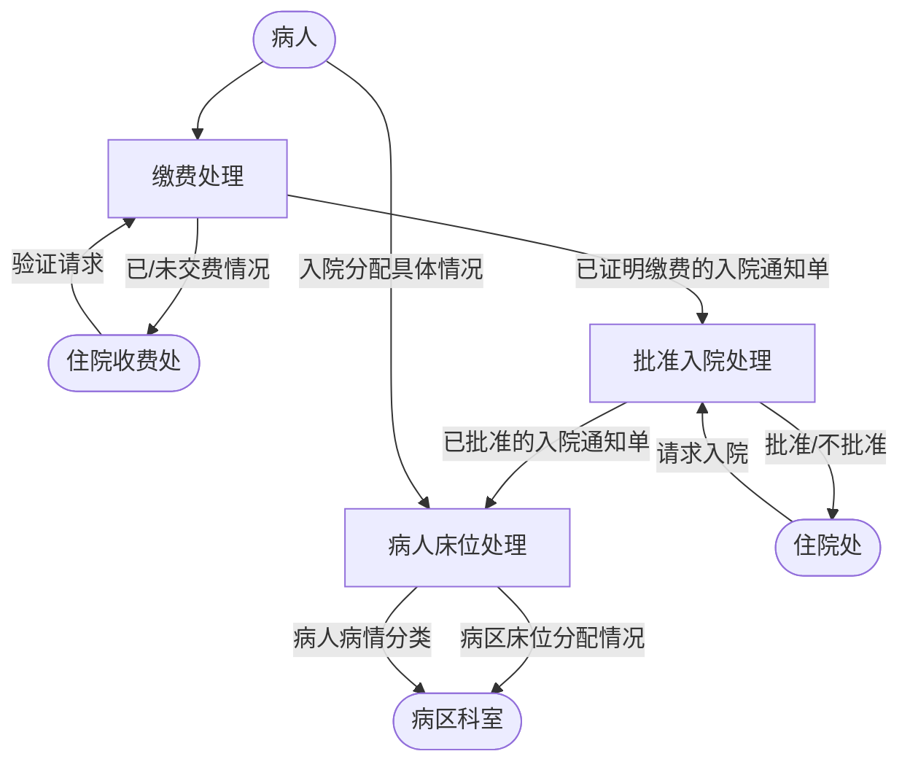

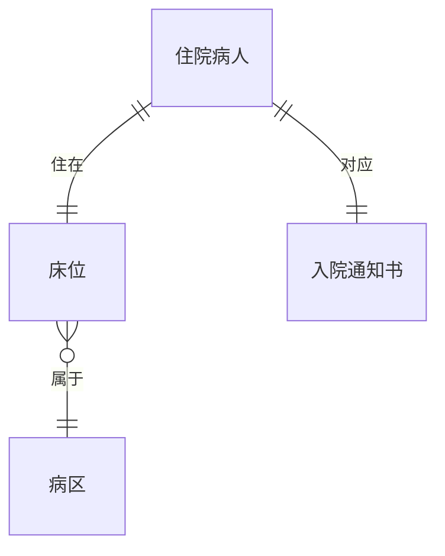

2.  **医生下达医嘱**
    流程解释:处理类医嘱包括:用药类长短期医嘱(可解释为住院处方),提请检查类医嘱(可解释为检查类项目),提请检验类医嘱(可解释为检验类项目)。先进行的是医嘱归档,将有关信息填入到住院病人本次住院的住院病案中,然后再将医嘱归类,进行相关的处理。察看此数据流图,可知，此分子系统的功能主要是围绕"医嘱"展开的,包括了"住院病案"、"住院处方"、"检查项目"、"检验项目"和"出院通知单"。因此,得到以下的E-R图:
    在此图中,将"医嘱"与"住院处方""检查项目""检验项目""出院通知单"的联系都称为"解释",即根据医嘱属性(见后合成子系统E-R图)中的"医嘱内容"来进行分类, 分送到病区医室或病人,病区科室将相关信息填入到"住院处方""检查项目""检验项目"中;而病人则持"出院通知单"在住院收费处进行相应的出院处理。

```mermaid
flowchart TD
    Ward([病区科室]) -->|处理类医嘱| Classify[医嘱分类]
    Classify -->|出院类医嘱| Patient([病人])
    InpatientDoctor([住院医师]) -->|下达医嘱| Archive[医嘱归档处理]
    Archive -->|归档病案| Record([住院病案])
```

```mermaid
erDiagram
    医嘱 ||--|| 归档 : "归档"
    归档 ||--|| 住院病案 : "归档到"
    医嘱 ||--|| 住院处方 : "解释1"
    医嘱 ||--|| 检查项目 : "解释2"
    医嘱 ||--|| 检验项目 : "解释3"
    医嘱 ||--|| 手术项目 : "解释4"
    医嘱 ||--|| 出院通知单 : "解释5"
```

3.  **住院处方的处理**
    流程解释:在生成了住院处方(根据医嘱归类)之后,病区科室将向中心药房提请药品,而在这首先必须先检查病人入院时之所缴押金是否还有余额,若无余额则向病人发出缴款通知,若有则要求发出药品。处方积累后将生成药品提领单,发往中心药房;而每张处方会生成对应病人的收费项目。药品由中心药房总括发往病区医室。察看此数据流图,可知道此分子系统的功能主要是围绕"住院处方"展开的。相关的还有"药品提领单"、"药品"、"收费项目"等。得E-R图如下:

```mermaid
flowchart TD
    InpatientCashier([住院收费处]) <-->|押金余额<br/>查询| Check[财政状况检查]
    Check -->|缴款通知| Patient([病人])
    Check -->|已批准住院处方| Dispense[取药处理]
    Check -->|住院处方| Ward([病区科室])
    Ward -->|分批药品| Dispense
    Dispense -->|药品提请单| CenterPharm([中心药房])
    CenterPharm -->|药品| Dispense
    Dispense -->|药品收费| Charge([收费项目])
```

4.  **检查检验项目处理**
    流程解释:在生成了检查检验项目(根据医嘱归类)之后,病区科室将向检查检验科室发出预约申请,而在这首先必须先检查病人入院时之所缴押金是否还有余额,若无余额则向病人发出缴款通知。得到批准后,病人将于预约的日期进行检查(如x光,B超,CT)或检验(如验血)。得到的结果返还病人,并记入检查项目、检验项目的相应属性中(见后合成E-R图的属性分析)。已检查或检验将生成相应的收费项目。察看此数据流图,可知，此分子系统的功能主要是围绕"检查项目"和"检验项目"展开的。相关的还有"检查预约"、"检验预约"、"收费项目"等。得E-R图如下:

```mermaid
flowchart TD
    InpatientCashier([住院收费处]) <-->|押金余额<br/>查询| Check[财政状况检查]
    Check -->|缴款通知| Patient([病人])
    Check -->|已批准检查检验类项目| Appoint[预约处理]
    Check -->|检查项目| Ward([病区科室])
    Ward -->|检查时间| Appoint
    Appoint <-->|预约<br/>批准| ExamDept([检查、检验科室])
    Appoint -->|已预约检查检验类项目| Process[检查检验处理]
    Process -->|检查结果| Patient
    Process -->|已检查、检验项目| Charge([收费项目])
```

```mermaid
erDiagram
    检验预约 ||--|| 检验项目 : "相应1"
    检验项目 ||--|| 收费项目 : "对应1"
    检查预约 ||--|| 检查项目 : "相应2"
    检查项目 ||--|| 收费项目 : "对应2"
```

5.  **手术处理**
    流程解释:在生成了手术项目(根据医嘱归类)之后,病区科室将向手术科室发出预约申请,而在这同样首先必须先检查病人入院时之所缴押金是否还有余额,若无余额则向病人发出缴款通知。得到批准后,病人将于预约的日期进行手术,并将过程和结果记入手术项目的相应属性中(见后合成E-R图的属性分析)。手术使用的器械和麻醉药品进行登记(在这里认为器械手术科室保管的,不涉及器械库; 而麻醉药品所涉及的药库在这里由于篇幅关系不再列出)。已手术项目将生成相应的收费项目。察看此数据流图,可知，此分子系统的功能主要是围绕"手术项目"展开的。相关的还有"手术预约"、"器械"、"麻醉药品"、"收费项目"等。得E-R图如下：
    其中,"预使"的取名含义在于麻醉药品的使用是要在手术之前进行的。

```mermaid
flowchart TD
    InpatientCashier([住院收费处]) <-->|查询| Balance[押金余额]
    Balance <-->|查询| Check[财政状况检查]
    Check -->|缴款通知| Patient([病人])
    Check -->|手术项目| Ward([病区科室])
    Ward -->|手术时间| Appoint[预约处理]
    Appoint <-->|批准<br/>预约| SurgeryDept([手术科室])
    Appoint -->|已批准手术项目| Approved[已批准手术项目]
    Appoint -->|已预约手术项目| Scheduled[已预约手术项目]
    Approved --> Process[手术处理]
    Scheduled --> Process
    Process <-->|使用器械、麻醉药品登记| Register[器械、麻醉药品登记]
    Process -->|已手术项目| Completed[已手术项目]
    Completed -->|已手术项目| Charge([收费项目])
    Charge -->|收费项目| Process
```

```mermaid
erDiagram
    手术项目 ||--|| 收费项目 : "对应"
    手术项目 ||--|| 手术预约 : "相应"
    手术预约 ||--|| 器械 : "使用"
    手术预约 ||--|| 麻醉药品 : "预使"
    手术项目 ||--|| 器械 : "使用"
```

6.  **病人出院**
    流程解释:出院时病人持出院诊断书,到住院收费处根据各种收费项目进行清算,退回剩余押金或补缴应缴款项,持其开出的票据办理出院手续,退回床位。根据此数据流图和已得出的数据字典,可知，此分子系统的功能主要围绕着"出院通知书"和"收费项目"展开,并连带与出院通知书相关的"病人"和与收费项目相关的"床位"、"住院处方"、"检查项目"、"检验项目"和"手术项目"等。因此,得到以下的E-R图:

```mermaid
flowchart TD
    Patient([病人]) --> Approve[批准出院处理]
    InpatientCashier([住院收费处]) -->|清算| Pay[缴费处理]
    Pay -->|已/未交费项目| Pay
    Pay -->|已证明缴费的出院通知单| Approve
    Approve -->|已批准的出院通知单| Bed[病人床位处理]
    Approve <-->|批准/不批准<br/>请求出院| InpatientDept([住院处])
    Bed -->|床位撤销分配<br/>病人出院| End([出院])
    Ward([病区科室]) -->|床位应交费项目| Bed
    Pay -->|出院通知单| Patient
```

根据以上的六步,经过汇总、去掉冗余和适当的删除一些与"住院"核心无关的实体,得到了以下的住院子系统汇总E-R图:

```mermaid
erDiagram
    门诊医生 ||--o{ 医生 : "继承"
    医生 ||--o{ 医嘱 : "下达"
    医嘱 ||--|| 住院医生 : "下达"
    医嘱 ||--|| 出院通知单 : "解释5"
    医嘱 ||--|| 住院处方 : "解释1"
    医嘱 ||--|| 检查项目 : "解释2"
    医嘱 ||--|| 检验项目 : "解释3"
    医嘱 ||--|| 手术项目 : "解释4"
    住院医生 ||--o{ 住院病案 : "负责"
    住院病案 }o--|| 住院医生 : "归档"
    住院病案 }o--|| 住院病人 : "相应"
    住院处方 ||--|| 收费项目 : "对应1"
    检查项目 ||--|| 收费项目 : "对应2"
    检验项目 ||--|| 收费项目 : "对应3"
    手术项目 ||--|| 收费项目 : "对应4"
    床位 ||--|| 收费项目 : "对应5"
    收费项目 }o--|| 住院病人 : "支付"
    住院病人 ||--|| 床位 : "住在"
    药品提领单 ||--o{ 床位 : "累积"
    药品提领单 ||--|| 病人 : "属于"
    病人 ||--|| 门诊病人 : "交付"
    病人 ||--|| 入院通知单 : "交付"
    病区 ||--|| 床位 : "包含"
    病区 ||--|| 药品提领单 : "管理"
```

相应的实体—属性关系如下:
1.  **病人**: (身份证号,姓名,出生日期, 性别,年龄,婚姻状况,职业,出生地,民族,国籍,工作单位及地址,电话,邮政编码,户口地址,联系人姓名,联系人地址,联系人电话,是否住院)
2.  **住院病人**: (住院号,姓名,入院科别,入院时间)
3.  **医生**: (医师编号,姓名,出生日期,出生地,民族,国籍,户口地址,婚姻状况,年龄,住址,电话,专业技术职务,备注)
4.  **住院医生**: (姓名,医师编号,所属科室,是否当值)
5.  **住院病案**: (病案号,病人姓名,住院号,入院科别,入院病室,入院时间,入院情况,转科情况,出院科别,出院科别,出院病室,出院时间,入院诊断,入院后确诊时间,出院诊断,出院情况,其他)
6.  **床位**: (床号,住院号,姓名,经管医生,护理人员号码,是否空床,治疗结果,床位租金,入院日期, 住院天数,交费方式)
7.  **病区**: (病区名,床位数,负责人,入住人数,出院人数,治愈率,好转率,未愈率,死亡率,诊断符合率,床位使用率)
8.  **医嘱**: (诊断序号,诊断类别,疾病编码,疾病名称,启用日期,处理日期,医嘱内容,领药量,主治医师,病人姓名,住院号,出院转归,病理符合)
9.  **住院处方**: (处方号,诊断序号,处方内容,主治医师,病人姓名,住院号,附注)
10. **检查项目**: (检查序号,诊断序号,病人姓名,住院号,检查类别,检查内容,检查日期安排,检查负责人员,检查结果,附注)
11. **检验项目**: (检验序号,诊断序号,病人姓名,住院号,检验类别,检验内容,检验日期安排,检验负责人员,检验结果,附注)
12. **手术项目**: (手术序号,诊断序号,手术名称, 手术室号,病人姓名,住院号,主刀医师,手术日期,麻醉方式,切口情况,手术持续时间,手术结果)
13. **收费项目**: (项目列号,项目内容,病人姓名,住院号,收费类型,收款日期,收款员,收款金额,结账情况,结账金额,是否转账)
14. **入院通知单**: (通知单号,门诊医师号,医师姓名,病人姓名,病人号,诊断建议,收费情况,批准与否)
15. **出院通知单**: (通知单号,住院医师号,医师姓名,病人姓名,病人号,诊断建议,收费情况,批准与否)

* **解释一**: 新加入的“医生”“病人”两个实体。它们分别是“住院医生”和“住院病人”的超类。之所以要这样,原因是由于“住院病人”与“门诊病人”有很多相同的属性,这样就造成了数据冗余。而如果让他们相同的属性由一个超类“病人”来拥有的话, “住院病人”与“门诊病人”就可以继承它的所有属性,这样也形成了与门诊子系统的接口。“住院医生”“门诊医生”和“医生”也是同样的处理。
* **解释二**: 对于各类型的预约,由于其功能比较单一,可在相应的项目中以“日期安排”的属性来完成其功能(如“检查项目”中用“检查日期安排”来代替“检查预约”)。这样就使总E-R图比较的简洁了。
* **解释三**: 手术项目中涉及到的麻醉药品与器械在此总图中没有反应(画图出现分叉)。由于麻醉药品从属于药品,因此在“手术项目”中以“麻醉方式”描述其小类编号、药库号和品名,这样就不用单述“麻醉药品”一个实体了 (“药品”的实体、属性在药品进出管理子系统中描述,因此总图也不涉及)。对于器械这一个实体,由于此次只有门诊、住院、药品管理三个子系统,没有涉及器械的管理,因此在此图中略去。如是一个完整的医院信息管理系统则应该加入。
* **解释四**: 在图中该加入“出院通知单”这一个实体。由于图中空余不够,因此没有画出。其应与病人发生联系(与“入院通知单”相同)。
* **解释五**: 对于“住院医生”这个实体应有“工作安排”的这样一个实体与之联系。但考虑到其只要与“医生”发生联系即可,这样的联系将在汇总E-R图是再考虑,本部分则略去。

至此,本部分的E-R设计大体已经结束。在相应实体的属性中,必然有相应的冗余部分,此外,与其余子系统的衔接还有待在汇总时考虑。

## 第 7 章 药品出入库管理子系统

**分E-R图**

```mermaid
erDiagram
    药库 ||--o{ 库存 : "1"
    库存 ||--o{ 药品 : "n"
    药库 ||--o{ 提交 : "1"
    提交 ||--o{ 药品请领单 : "n"
    药品 ||--o{ 参照 : "1"
    参照 ||--o{ 订单细则 : "n"
    药品 }o--o{ 供应 : "n"
    供应 }o--o{ 供应商 : "m"
    供应商 ||--o{ 交付 : "1"
    交付 ||--o{ 订单 : "n"
    订单 ||--o{ 组成 : "1"
    组成 ||--o{ 订单细则 : "n"
    药品请领单 ||--o{ 生存 : "1"
    生存 ||--o{ 门诊处方 : "n"
    药品请领单 ||--o{ 生存 : "1"
    生存 ||--o{ 住院处方 : "n"
```

### 7.1 实体及属性
* **供应商**：{供应商号，地址，电话，信贷状况}；
* **订单**：{订单号，供应商号，订货项数，订货日期，交货日期，生产地点}；
* **药品**：{小类编号，品名，规格，单位，数量，单价，金额，生产日期，保质期}；
* **药库**：{药库号，负责人，类别，面积}；
* **订单细则**：{订单号，细则号，药品编号，单价，数量，规格，总价，批号}；
* **药品请领单**：{编号，领用单位，药品名称，规格，领药量，单价，金额}。

# 第三篇 逻辑设计

在概念设计的基础上，根据设计得到系统总的E-R图，按照概念模式与关系表转化的一般规则，结合实际的需要进行逻辑设计，E—R图中的实体、实体的属性和实体之间的联系转化为关系模式。最后生成的关系及关系表如下（同时附优化说明）：

## 第 8 章 表的设计及优化说明

### 8.1 门诊子系统部分

**1．挂号单(挂号号、挂号类别、挂号日期、科室、病人号、医师号)**
说明:由实体型生成的关系模式,由于门诊医师和挂号单的联系是1:1,因而将其加入门诊医师的主码加入到挂号单所形成的关系模式中。
优化说明：由于挂号人姓名与病人号，医师号与主治医师有冗余故删除主治医师和挂号人姓名；另外，挂号科室与后面的科室存在异名同义的矛盾，故改名为科室。

**2．处理方案（处理方案号、医师号、开出时间、处理方案内容）**
说明:由处理方案形成的关系模式,门诊医师与处理方案之间为１：ｎ，故将门诊医师的主码加入到处理方案的关系模式中来。

**3．门诊病历（病历号、病人号、病历内容、诊断时间、医师号、处方号）**
说明:由门诊病历形成的关系模式,而门诊病历与门诊处方的联系为1:1,故将门诊处方的主码处方号加入到门诊病历关系模式中。另门诊病人与门诊病历为１：１，故将病人号加入到门诊病人中；另主治医师好改为医师号。
优化说明：医师号与主治医师有冗余，故删除主治医师。

**4．门诊处方（处方号、处理方案号、门诊收费项目号、请领单单号、处方内容、病人号、医师号、附注）**
说明：处理方案与门诊处方以及收费项目与门诊处方均为１：ｎ。故将处理方案号、门诊收费项目号加入到其中。
优化说明：主治医师、病人姓名、病人性别、病人年龄等均是冗余数据，故均应删除，这是因为处方号可函数推导出病人号，而病人号则可函数推导出病人的所有上述信息，故将其删除。

**5．门诊收费项目（门诊收费项目号、挂号号、支付时间、项目类型、相应序号、收费金额、收费人员、病人号）**
说明:由门诊收费项目形成的关系模式，又门诊收费项目与挂号单为１：１，故将挂号号加入到其中。

**6．门诊医师（医师号、科室、当值日期）**
优化说明：门诊医师中的属性：姓名,专业技术职称,性别,出生日期,年龄,婚姻状况,职业,出生地,民族,身份证号,国籍,住址,电话,邮政编码,户口地址, 备注均可有医师号函数推出，故将它们删除。

**7．门诊病人（病人号、就诊时间、交费情况）**
优化说明：由于姓名、年龄、性别可由病人号函数推出，故将其删除。

**8．门诊检验项目（检验序号、医师号、门诊检验时间安排、门诊检验内容、门诊检验分析门诊检验结果、门诊收费项目号、处理方案号）**
优化说明：检验收费情况可由门诊收费项目号函数推导。检验医师与医师号冗余，故删除。

**9．门诊检查项目（检查序号、医师号、门诊检查时间安排、门诊检查内容、门诊检查分析、 门诊检查结果、门诊收费项目号、处理方案号）**
优化说明同门诊检验项目。

**10．工作时间安排（工作时间、科室、医师号）**
优化说明：其中的病假情况、事假情况可由医师关系模式中主码医师号函数推出。

**11．挂号收费（挂号号、门诊收费项目号、收费金额）**
说明:由挂号单与门诊收费项目之间形成的一种联系,收费金额是挂号收费的属性。

**12．缴纳（病人号、门诊收费项目号、缴纳金额）**
说明:由门诊病人和门诊收费项目之间形成的一种联系,缴纳金额是缴纳的属性。

### 8.2 住院子系统部分

**13．住院收费项目(项目序号,项目类型,相应序号,收费类型,收费金额,收款员,结账情况,结账金额,是否转账);**
说明: “项目类型”是指处方,检查,检验,手术或住院;“项目类型” 是指处方序号, 检查序号, 检验序号,手术序号或入住序号(床位); “收费类型” 是指公费或私费;

**14．医嘱 (诊断序号,诊断类别,启用日期,处理日期,医嘱内容,医师号, 住院号,疾病编码);**
说明: “诊断类别”指的是医嘱的序号;“诊断类别” 是指处方, 检查, 检验,或手术; “医嘱内容”是指处方, 检查, 检验,或手术的相关内容
优化说明：其中的主治医师姓名与医师号，住院号与病人姓名，疾病编码与疾病名称这些两两实体之间局存在冗余，故将主治医师姓名、病人姓名、疾病名称均删除。

**15．住院处方( 住院处方号,诊断序号,处方内容,医师号, 住院号,请领单号,附注);**
说明: “附注” 是指处方上的注意事项;“药品提领单号”对应由住院处方积累而成的药品提领单。
优化说明：主治医师号与医师号是异名同义，故改名为医师号。

**16．住院检查项目( 检查序号, 诊断序号,住院检查日期安排, 住院检查负责人员,住院号,住院检查内容, 检查结果);**

**17．住院检验项目（检验序号, 诊断序号,住院检验日期安排,住院检验负责人员,住院号, 住院检验内容,住院检验结果);**

**18．手术( 手术序号,医师号,住院号,手术名称,手术持续时间,手术结果,麻醉方式,切口情况, 手术室号);**

**19．住院病人(住院号, 病人名, 入院时间, 转科情况, 入院科别,出院科别);**

**20．住院医师( 医师号,科室);**

**21．床位(床号,值班人员号,床位租金,是否空床, 所属病区)**

**22．病区(病区名,负责人号,床位数,入住人数,出院人数,治疗率,好转率, 未愈率, 死亡率, 诊断符合,床位使用率);**

**23．医师( 医师号,姓名,专业技术职称,性别,出生日期,年龄,婚姻状况,职业,出生地,民族,身份证号,国籍,住址,电话,邮政编码,户口地址, 备注);**

**24．病人( 病人号,姓名,性别,出生日期,年龄,婚姻状况,职业,出生地,民族,身份证号,国籍工作单位及地址,电话,邮政编码,户口地址,联系人姓名,联系人地址,联系人关系，是否住院, 联系人电话);**

**25．住院病案( 病案号,病人号,入院科室, 病室,入院日期, 入院诊断,入院情况, 转科情况, 出院科别,出院病室, 出院时间,出院诊断,入院确诊日期,出院情况)**
说明: 入院情况是指危,急,一般等; 出院情况是指治愈,好转,无效,加重,死亡及其他情况;

**26．住院医生-病人(医师号,住院号,床号,开始日期,结束日期);**
说明:由联系“附注”做出此表,因为病人与住院医生之间是m对n的关系;而且该联系有自己的属性如“开始日期” “结束日期”；
优化说明：病人号与住院号之间存在冗余，将病人号删除。

**27．医嘱-病案(诊断单序号,病案号,合并日期 )**
说明: 由联系“归档”做出此表。由于“合并日期”此属性需单独列表反映;其指的是医嘱归入病案的日期。

**28．病人-床位(入住序号,病人号,床位号,床位所属病区号,治疗结果,住院天数, 入住时间,退床时间);**
说明: 由联系“入住”做出此表,与“收费项目”便发生联系。之所以要这么做,是由于“床位”项目与“检查项目” 和“检验项目” “手术项目”是不同的,床位可以没有病人入住,因此不发生收费;而其余几个只要有元组存在就一定是要收费的。此外治疗结果,住院天数, 入住时间,退床时间等属性放于此表反映是较好的。

**29．医嘱-手术(手术序号,诊断序号,医师号,住院号)**
说明: 由联系“解释4”做出此表。 之所以要这么做,是由于“手术”项目的特殊性。其主要反映的是手术的种种特性,如主刀医师等,以供单独的查询;将手术序号,诊断序号,主治医师号,主治医师姓名,住院号, 病人姓名等加入到“手术”中则破坏了独立性,因此单独列表。

### 8.3 药品出入库子系统部分

**30．供应商（供应商号，地址，电话，信贷情况）；**

**31．订单（订单号，供应商号，订货项数，订货日期，交货日期，生产地点）；**

**32．药品（药品编号，药库号，品名，规格，单位，数量，单价，金额，生产日期，保质期）；**

**33．药库（药库号，负责人，类别，面积）；**

**34．订单细则（订单号，细则号，药品编号，单价，数量，规格，总价，批号）；**

**35．药品请领单（请领号，药库号，领用单位，药品名称，规格，领药量，单价，金额）。**

**36．供应（产品号，供应商号，供应量）；**

**37．生成（请领单，处方号，生成量）；**

注：
药品关系表中包含联系“库存”；
订单关系表中包含联系“交付”；
订单细则关系表中包含联系“参照”、“组成”；
药品请领单关系表中包含联系“提交”。

## 第 9 章 关系表总体设计说明

由于本系统在进行概念模型设计的时候各个系统的负责人之间曾进行过多次交流，因此在合成的时候没有太多的冲突。各个部分也能比较好地结合到一起。

对于门诊检查项目和住院检查项目两张表不进行合并的说明：
1.  门诊检查项目（检查序号、医师号、门诊检查时间安排、门诊检查内容、门诊检查分析、门诊检查结果、门诊收费项目号、处理方案号）
2.  住院检查项目( 检查序号, 诊断序号,住院检查日期安排, 住院检查负责人员,住院号,住院检查内容, 检查结果);

这两个关系表由于其中有些字段保留了不同的必要信息，因此无法进行合并成为一个表，即是在用户模式下，同一个用户（检查部门工作人员）必须基于两个逻辑表，这里也没有必要像门诊病人与住院病人一样用一个超类病人来处理。

同样，门诊检验项目和住院检验项目也处理为两个没有直接联系得关系住院收费项目和门诊收费项目之间分成两个关系表处理的原因与上边说明的类似。

## 第 10 章 设计用户子模式

在将概念模型转化为全局逻辑模型后,根据医院系统的局部应用需求,以下设计用户子模式， 考虑以下的几个需求:
⑴探望人员查阅病人信息
⑵病人查阅其账户信息
⑶医生查阅病人病案信息
⑷院领导综合查询

### 10.1 定义用户级别

对行政管理人员(院领导),医师,病人,院外探视人员的级别定义如下:
⑴行政管理人员:对所有表的所有内容都有查看的权限
⑵医师:对自己所负责病人的所有有关住院病案、门诊病历有修改和查阅的权限,对自己本人的在医师表中的有关项目有查阅的权限
⑶病人:对自己在收费项目、检查项目、检验项目、手术项目、处方项目中所占的元组有查看的权限。
⑷院外探视人员:对病人-床位的相应项目有查阅权限

### 10.2 制作查询子系统:

根据分析需求,我们设计了以下几个查询系统:医生辅诊子系统、医院领导综合查询子系统、患者导医子系统、探视查询子系统。

**医院领导综合查询子系统**
提供对医院的医疗管理、经济管理、行政管理方面的信息的各种查询和统计,如:门诊收入、住院收入、药品收支、物资情况、医疗信息、病区床位使用率等信息。提供报表打印和图形显示,供院领导作辅助决策之用。
在这里创建几个视图:
* **收入类**(门诊类收入,住院类收入,月份,总费用,利润,与去年同期相比增长额)
    注:门诊类收入由门诊收费项目表的所有收费金额总计计算,一月一次;住院类收入由住院收费项目表的所有收费金额总计计算,同样一月一次。总费用由费用表总计提供(本系统未列入),前两者两者相加减去总费用,可计算利润。和去年的本视图的同期利润金额进行比较,得出与去年同期相比增长额。
* **药品收支**(药品收入,药品支出,管理费用,月份,利润)
    注: 药品收入由药品请领单表的金额每月总计得出;药品支出由供应表中的供应量和药品表中相应药品的单价相乘得出;管理费用由费用表中的有关药品库存管理的费用总计得出,每月一次。利润项由药品收入-药品支出-管理费用得出。
* **医师工作量**(医师姓名,医师号,本月工作量,基本工资,奖金)
    注:本月工作量由工作时间安排表中的工作时间每月总计推出;根据工作量和医师表中的专业技术职称计算其奖金;从基本工资表中得出其基本工资(本系统未列入)。
* **病区床位**(病区名,负责人姓名,床位数,入住数,收入,病区床位使用率)
    注:病区名,负责人姓名,床位数,入住数,病区床位使用率到病区表中提取;收入到住院收费项目表中的有关床位收费的金额总计提取。
* 以上的所有视图院领导都有查询的权限

**医生辅诊子系统**
提供给门诊医生或住院医生使用。
①可用于下达各类长短期用药医嘱、门诊处方、书写门诊病历、提交检查/检验申请。有关信息可供中心药房、门诊药房或各类医技科室(检查检验等)查用。
②可查阅检查检验报告、病案首页和病人体征信息
提供以下几个视图:
①门诊病人(病人名,病人号,门诊病历号,辅助内容)
注: 门诊医生只有查阅自己主治的病人的门诊病历号的权限。
②住院病人(病人名,病人号,门诊病历号,住院病案号,辅助内容)
注: 住院医生只有查阅自己主治的病人的门诊病历号和住院病案号的权限。
由以上的两个视图可获得相应的门诊病历号和住院病案号从而可以进行相关的门诊病历、病案首页和病人体征信息查询。

**患者导医子系统**
提供给门诊病人和住院病人及其家属使用。
⑴供病人自助查询医院基本情况,包括:医院布局、科室介绍、医生介绍、诊疗项目价格、药品价格、用药咨询、门诊程序、住院程序、陪护制度、探视制度等。
⑵病人可查询自己的诊疗费用明细账
① 收费项目(序号,内容,金额)
注:病人只能察看本人的有关收费项目。从住院收费项目和门诊收费中提取。序号对应的是:住院收费项目的项目序号或门诊收费项目的收费项目号;内容对应的是相应表中的项目类型;金额对应的是相应表中的收费金额。
②:医师(医师姓名,职称,科室,是否当值)
注:病人察看相关的医师信息。医师姓名从医师表中提取; 职称从医师表中的专业技术职称提取;科室从分属的门诊医师和住院医师表的科室提取;是否当值从工作时间安排表的工作时间推出。

**院外人员查询子系统**
提供给院外探视人员使用。供其查阅病人基本信息。
创建视图如下:
视图:病人住宿(病人名,床位,病区)
首项由住院病人表中的病人名提供;第二项由病人、床位表中的病人号和床位号提供;床位表中的病区提供第三项。院外探视人员对此视图有查阅权限。

# 第四篇 物理设计

医院管理信息系统是多用户共享的系统，对同一个关系要建立多条存储路径，才能满足多用户的多种应用要求。在数据库设计中，可供选用的存储方法主要有三种：B＋树索引方法、聚簇方法、HASH方法。其中，B＋数索引方法发展较为完善，也是目前大型数据库使用的经典存取方法，使用最为普遍，并且符合本系统的要求，因此，我们采用Ｂ＋树索引方法作为系统的存取方法。

**一、建立索引的依据**
所谓选择索引存取方法实际上就是根据应用要求确定对关系的哪些属性列建立索引、哪些属性列建立组合索引、哪些索引要设计为唯一索引等。根据本信息系统的具体情况，建立索引的依据如下：
* 一个属性经常在查询条件下出现。
* 一个属性经常作为最大值或最小值等聚集函数的参数。
* 一个属性经常在连接操作的连接条件出现。

**二、需要建立索引的属性**

| 属性名 | 对应实体 | 属性名 | 对应实体 |
| :--- | :--- | :--- | :--- |
| 病历号 | 门诊病历 | 诊断序号 | 医嘱 |
| 处方号 | 门诊处方 | 医嘱内容 | 医嘱 |
| 医师号 | 门诊医师 | 住院号 | 医嘱 |
| 科室 | 门诊医师 | 疾病编码 | 医嘱 |
| 当值日期 | 门诊医师 | 住院处方号 | 住院处方 |
| 病人号 | 门诊病人 | 住院检查日期安排 | 住院检查项目 |
| 门诊检验时间安排 | 门诊检验项目 | 检查结果 | 住院检查项目 |
| 门诊检验结果 | 门诊检验项目 | 住院检验日期安排 | 检验项目 |
| 门诊检查时间安排 | 门诊检查项目 | 住院检验结果 | 检验项目 |
| 门诊检查结果 | 门诊检查项目 | 手术序号 | 手术 |
| 工作时间 | 工作时间安排 | 手术名称 | 手术 |
| 收费金额 | 挂号收费 | 手术持续时间 | 手术 |
| 项目序号 | 住院收费项目 | 住院号 | 住院病人 |
| 收费金额 | 住院收费项目 | 入院时间 | 住院病人 |
| 收款员 | 住院收费项目 | 医师号 | 住院医师 |
| 供应商号 | 供应商 | 科室 | 住院医师 |
| 床号 | 床位 | 联系人电话 | 病人 |
| 值班人员号 | 床位 | 病人号 | 病人 |
| 是否空床 | 床位 | 联系人姓名 | 病人 |
| 病区名 | 病区 | 是否住院 | 病人 |
| 负责人号 | 病区 | 病案号 | 住院病案 |
| 诊断单序号 | 医嘱-病案 | 病人号 | 住院病案 |
| 病案号 | 医嘱-病案 | 入院日期 | 住院病案 |
| 床号 | 住院医生-病人 | 药品编号 | 药品 |
| 开始日期 | 住院医生-病人 | 药库号 | 药品 |
| 结束日期 | 住院医生-病人 | 生产日期 | 药品 |
| 入住序号 | 病人-床位 | 保质期 | 药品 |
| 病人号 | 病人-床位 | 药库号 | 药库 |
| 床位号 | 病人-床位 | 负责人 | 药库 |
| 床位所属病区号 | 病人-床位 | 订单号 | 订单细则 |
| 订单号 | 订单 | 订单细则 | 订单细则 |
| 生产地点 | 订单 | 请领单号 | 药品请领单 |

**三、确定数据库的存储结构**

本部分主要是确定数据库物理结构，即确定数据的存放位置和存储结构，包括确定关系、索引、聚簇、日志、备份等的存储安排和存储结构，确定系统配置等。在综合考虑存取时间、存储空间利用率和维护代价三方面的因素下，经过权衡，确定下数据的存放位置和存储结构。

* **确定数据的存放位置**：为了提高系统的性能，根据应用情况将数据的易变部分与稳定部分、经常存取部分与存取效率较低部分分开存放。考虑到目前许多计算机都有多个磁盘，因此将表（如药库子系统表）和索引放在不同的磁盘上，在查询时，两个磁盘驱动器并行工作，可以大大提高I/O读写的效率；而对于较大的表（如门诊子系统的表）则分放在两个磁盘上，这样可以加快存取速度，在多用户环境下的作用更有效；为了改进系统的性能，将日志文件与数据库对象（表、索引等）放在了不同的盘上。

**四、确定系统配置**

在数据库设计初始阶段，为了对以后的数据库进行物理优化，提供了一些系统配置变量、存储分配系数，并对这些变量赋予了合理的缺省值。但是这些值不一定适合每一种应用环境，在进行物理设计时，对这些变量重新赋值，以改善系统的性能。

对系统配置的变量，例如：同时使用数据库的用户数，同时打开的数据库对象数，内存分配参数，缓冲区分配参数（使用的缓冲区长度、个数），存储分配参数，物理块的大小，物理块装填因子，时间片大小，数据库的大小，锁的数目等。这些参数值直接影响存取时间和存储空间的分配，在物理设计时应根据应用环境确定这些参数值，以使系统性能最佳。